<div align="center">

<a href="https://rememberanyth.ing"></a>

<br>

**Remember any number. Your card, your passport, your mum's phone, or a hundred digits of π.**

Chunk it, type it back, and review it until it sticks.<br>
No accounts, no servers. Nothing you type ever leaves your browser.

<br>

<a href="https://rememberanyth.ing"></a>

<br><br>


<br><br>

<a href="https://rememberanyth.ing">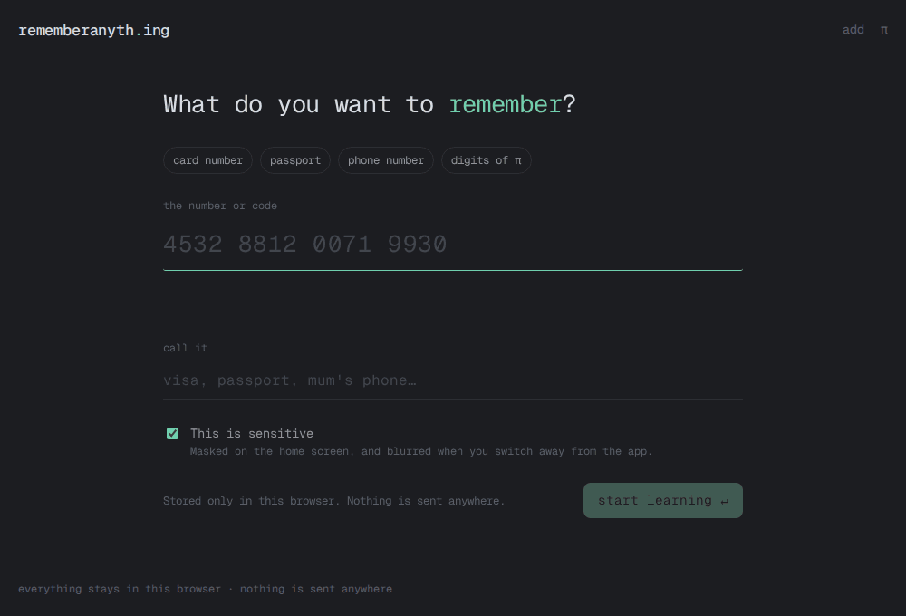</a>

<sub>Learning a card number in about 15 seconds, one deliberate mistake included. Recorded on <a href="https://rememberanyth.ing">rememberanyth.ing</a>.</sub>

</div>

<br>

## How it works

Most people can hold about four things in their head at once. A 16-digit card number is sixteen things. rememberanyth.ing breaks it into four, then makes you prove you know each one before moving on.

<table>
  <tr>
    <td width="33%">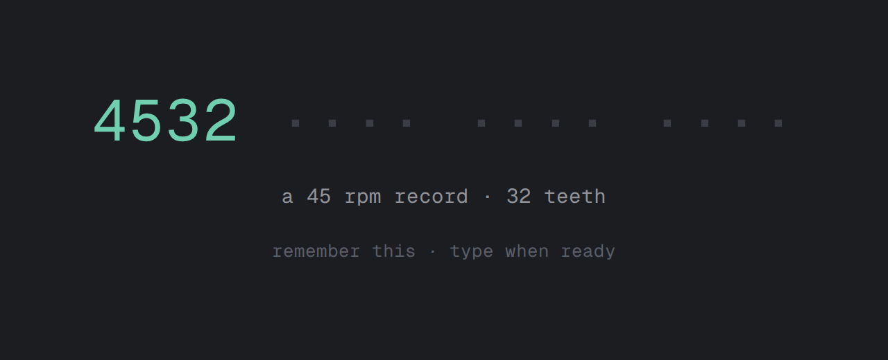</td>
    <td width="33%">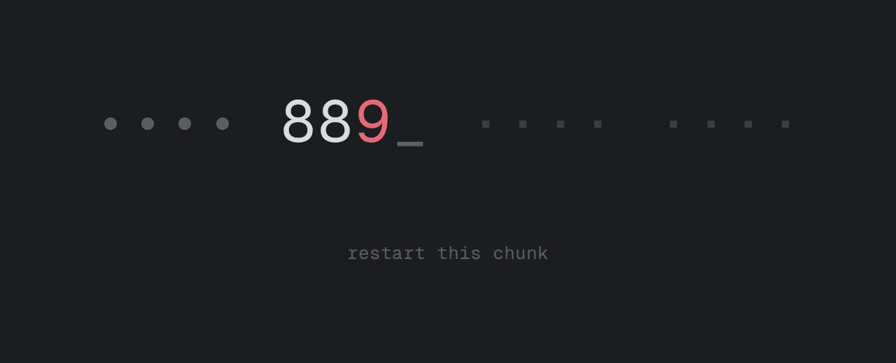</td>
    <td width="33%">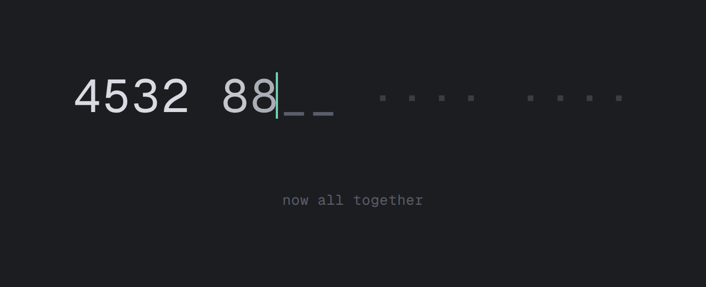</td>
  </tr>
  <tr>
    <td align="center"><b>See it</b><br><sub>One chunk fades in with a hook:<br>88 piano keys, 12 a dozen eggs</sub></td>
    <td align="center"><b>Type it</b><br><sub>A wrong digit restarts that chunk,<br>never the whole number</sub></td>
    <td align="center"><b>Chain it</b><br><sub>Each new chunk is typed together<br>with the ones before it</sub></td>
  </tr>
</table>

1. **See it.** One chunk appears with a hook to hang it on. It stays until you're ready.
2. **Type it.** Start typing and it disappears. Now it comes from memory.
3. **Miss, and try that chunk again.** Only the chunk you missed restarts. Miss twice and it shows you once more.
4. **Chain it.** After each new chunk, you type everything learned so far from the start.
5. **One clean run.** The whole number, no hints, no mistakes.
6. **Come back.** Reviews arrive 1, 3, 7, 16, 35 and 90 days later. Each one takes about ten seconds.

## Screens

<table>
  <tr>
    <td width="50%">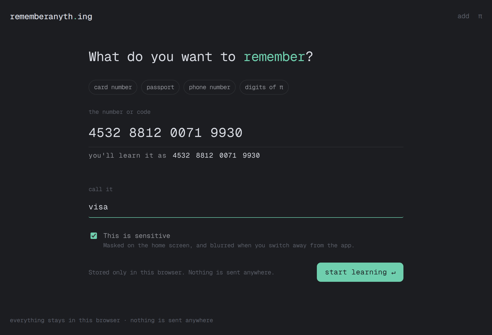</td>
    <td width="50%">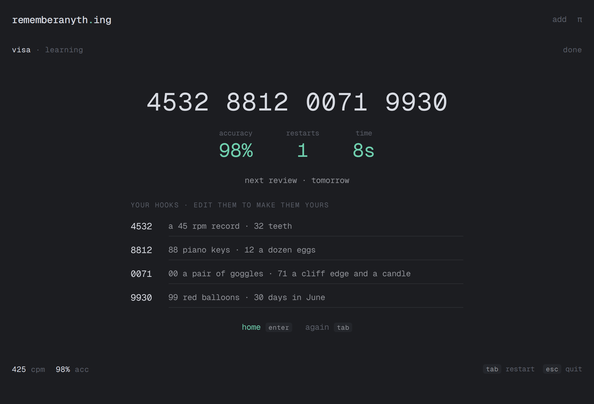</td>
  </tr>
  <tr>
    <td align="center"><sub><b>Add anything.</b> Paste it and see how it'll be chunked.</sub></td>
    <td align="center"><sub><b>Results.</b> Edit the hooks to make them yours.</sub></td>
  </tr>
  <tr>
    <td width="50%">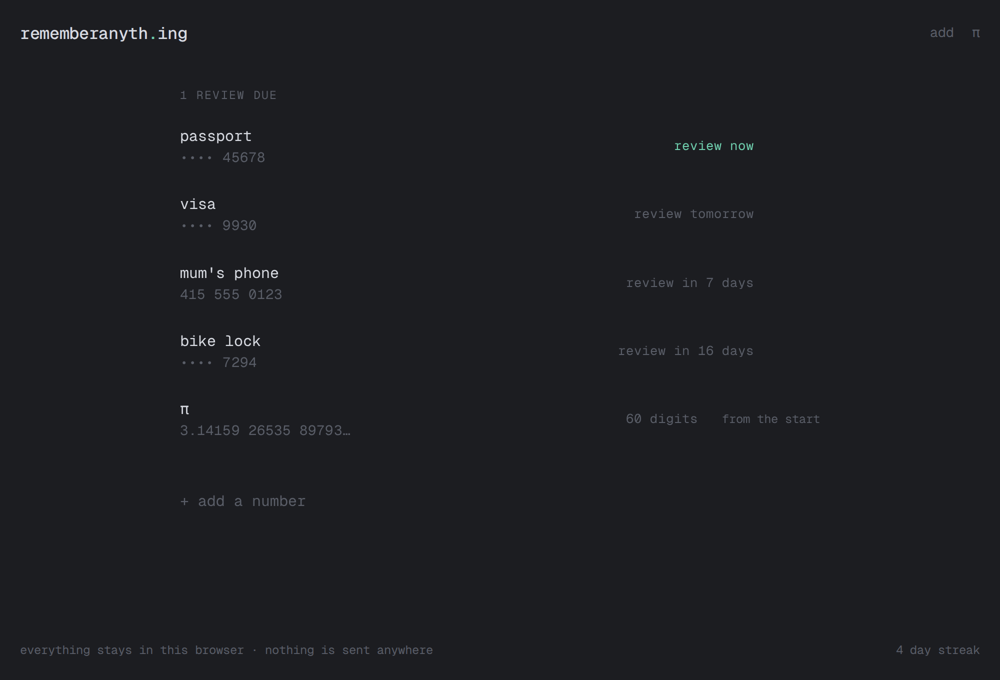</td>
    <td width="50%">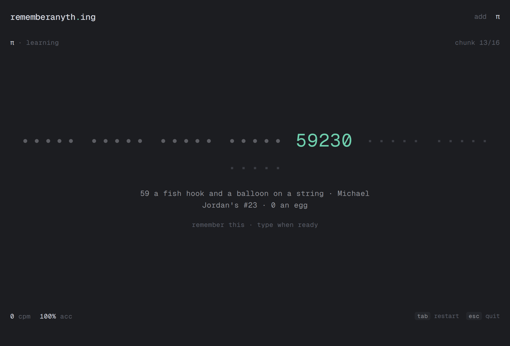</td>
  </tr>
  <tr>
    <td align="center"><sub><b>Your numbers.</b> Sensitive ones stay masked. Reviews surface when due.</sub></td>
    <td align="center"><sub><b>π mode.</b> Twenty new digits a round, as far as you want to go.</sub></td>
  </tr>
</table>

<div align="center">
  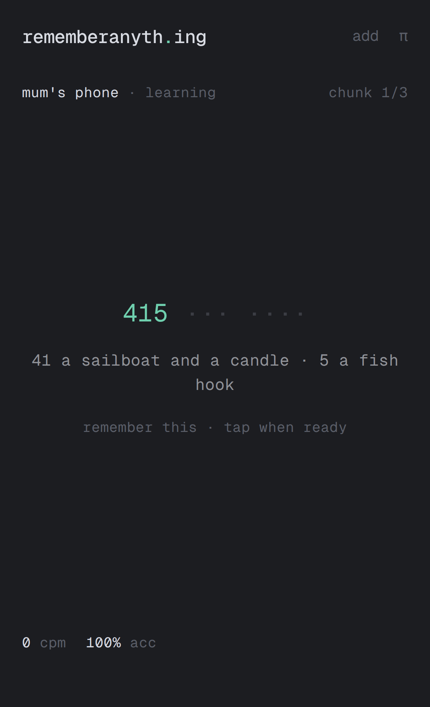
  &nbsp;&nbsp;&nbsp;
  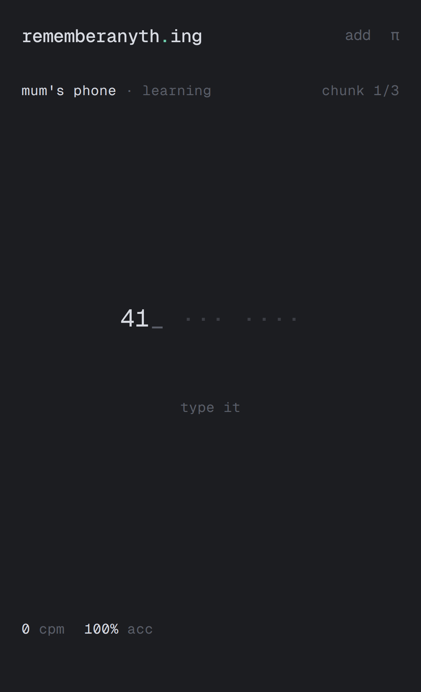
  <br>
  <sub><b>On your phone too.</b> The number pad opens automatically, and it installs like an app.</sub>
</div>

## Why it works

None of this is new. It's what memory research has said for decades, packaged so you don't have to think about it.

| Idea | How it shows up here |
|---|---|
| **Chunking** | Working memory holds roughly four items. Four chunks of four digits fit; sixteen loose digits don't. |
| **Retrieval practice** | Pulling something out of memory strengthens it far more than reading it again. You never re-read here. You type. |
| **Spaced repetition** | Reviewing just before you'd forget is the cheapest way to remember for good. The schedule handles the timing. |
| **Hooks** | A number tied to something vivid (88 piano keys, 1969 the Moon landing) is easier to find later. You can rewrite every hook in your own words. |

## Private by design

You're typing your passport and card numbers into this, so the privacy promise has to be literally true.

- **No backend.** It's a static site. There is no server to send anything to.
- **No accounts, no analytics, no third parties.** Fonts are self-hosted, and a strict content security policy (`default-src 'self'`) blocks anything else from loading.
- **Stored only in your browser** (IndexedDB). Clear your site data and it's gone.
- **Sensitive numbers are masked** on the home screen and blurred when you switch away from the tab.
- **Forget a number** and it's deleted for real.

## Keyboard

| Key | What it does |
|---|---|
| any key | ends the flash and counts as your first digit |
| <kbd>space</kbd> | ends the flash without typing |
| <kbd>tab</kbd> | restart the session |
| <kbd>esc</kbd> | quit to home |
| <kbd>enter</kbd> | back home from the results |

## Run it locally

```sh
pnpm install
pnpm dev        # http://localhost:5173
pnpm test       # engine unit tests (Vitest)
pnpm e2e        # end-to-end tests (Playwright)
pnpm build      # static site in dist/
```

To refresh the screenshots and demo above from the live site, run `pnpm media` (needs `ffmpeg`).

<details>
<summary><b>Project layout</b></summary>

```
src/
  engine/          the logic, pure TypeScript with no DOM
    session.ts       the learning loop as a reducer: flash → recall → chain → final
    chunk.ts         input cleanup and chunking (4-4-4-4, 3-3-4, or your own grouping)
    srs.ts           the 1 / 3 / 7 / 16 / 35 / 90 day review ladder
    hooks.ts         hook suggestions from data/hooks.json
  data/
    hooks.json       curated number associations
    pi.ts            10,000 decimals, generated by scripts/gen-pi.mjs
  store/db.ts      IndexedDB storage, with an in-memory fallback
  ui/              the digit line, session screen and Graphite theme
  screens/         home, add, learn/review, π
scripts/
  gen-pi.mjs       computes π with Machin's formula
  capture-media.mjs  records the README screenshots and demo
docs/
  features/        product requirement docs for upcoming features
```

</details>

## Future features

<table>
  <tr>
    <td width="50%" valign="top">
      <h3>Memory palace</h3>
      <p>The technique memory champions use, set up for you. Scan a room you know with your phone (a 3D scan where LiDAR is available, or a quick photo walk), pick a route of objects through it with a short guided orientation, and a diffusion model paints a vivid scene for each chunk right on your own furniture. To recall, you walk the palace and type what you see.</p>
      <p>Built for long sequences like 100+ digits of π. Secret numbers are still assembled on your device only.</p>
      <p><a href="docs/features/memory-palace/plan.md"><b>Read the PRD →</b></a></p>
    </td>
    <td width="50%" valign="top">
      <h3>Daily challenge</h3>
      <p>One memory challenge a day, the same for everyone, one attempt. Memorize a fresh random sequence against the clock, recall it, and see where you landed on today's histogram. Compete in private groups with friends, keep your streak, and share a spoiler-free result card to the group chat, like <a href="https://enclose.horse/">enclose.horse</a>.</p>
      <pre>daily #42 · digits
🟩🟩🟩🟩 🟩🟩🟩🟩 🟩🟩🟨⬛ ⬛⬛⬛⬛
34/40 · top 12% · 🔥 6 days</pre>
      <p><a href="docs/features/daily-challenge/plan.md"><b>Read the PRD →</b></a></p>
    </td>
  </tr>
</table>

<br>

<div align="center">
  <a href="https://rememberanyth.ing"><b>rememberanyth.ing</b></a>
  <br>
  <sub>For everyone who has ever dug out their passport to fill in a form.</sub>
  <br><br>
  Built by <b>Michael Tan</b> · <a href="https://github.com/mictan27/remember-anything">github.com/mictan27/remember-anything</a>
</div>
